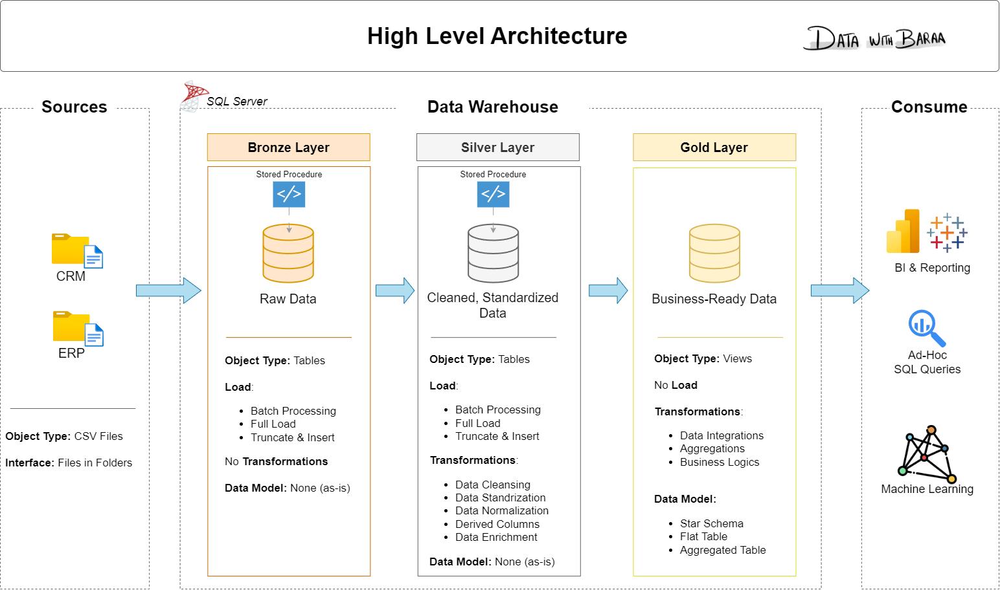
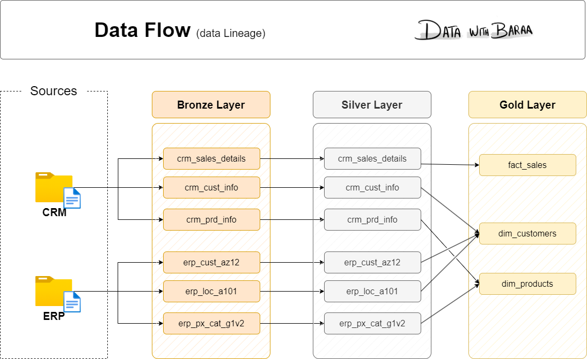
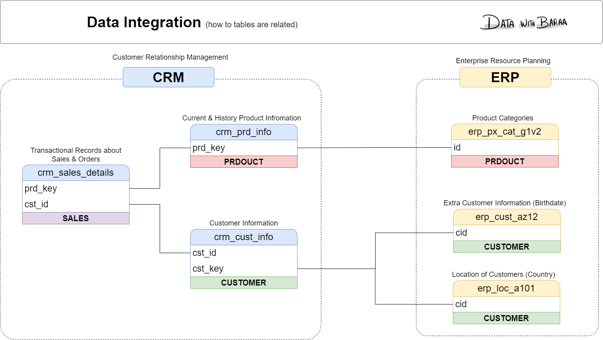
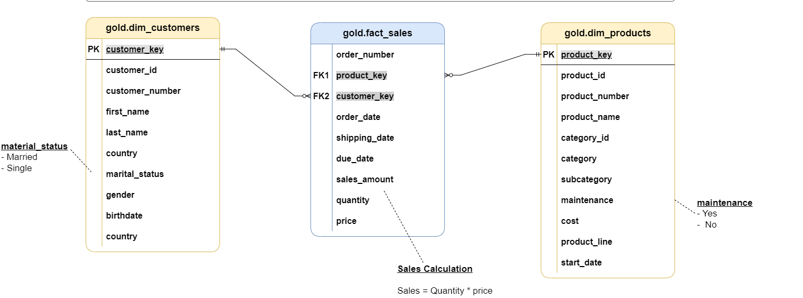

# 🏗️ SQL Data Warehouse Project

Welcome to the **SQL Data Warehouse and Analytics Project**! This repository showcases an end-to-end data warehousing and business intelligence solution—from raw data ingestion to analytics-ready data modeling—designed using modern data engineering best practices.

---

## 📖 Project Overview

This project implements a modern **Medallion Architecture** (**Bronze**, **Silver**, and **Gold** layers) using SQL Server to consolidate, cleanse, and model data from multiple enterprise source systems (**ERP** and **CRM**). 

### Key Objectives:
1. **Data Architecture:** Design a scalable multi-layered data warehouse using Medallion Architecture principles.
2. **ETL Pipelines:** Build automated SQL stored procedures to extract, transform, and load CSV datasets into structured relational tables.
3. **Data Modeling:** Develop an analytics-optimized **Star Schema** (Fact and Dimension tables) for reporting and BI consumption.
4. **Data Quality & Testing:** Implement automated SQL validation scripts to ensure data accuracy, completeness, and referential integrity across layers.

---

## 🏛️ Data Architecture

The data warehouse follows the **Medallion Architecture** to progressively refine data quality as it moves through the pipeline:

<p align="center">
  
</p>

* **🥉 Bronze Layer (Raw Ingestion):** Stores raw, unaltered data extracted directly from CRM (`cust_info`, `prd_info`, `sales_details`) and ERP (`CUST_AZ12`, `LOC_A101`, `PX_CAT_G1V2`) CSV files.
* **🥈 Silver Layer (Cleansed & Standardized):** Applies data cleansing, standardization, deduplication, null handling, and data type casting to prepare reliable datasets.
* **🥇 Gold Layer (Business-Ready):** Models the data into a business-friendly **Star Schema** with well-defined Fact and Dimension views for analytical queries.

---

## 🔄 ETL Pipeline & Data Flow

The end-to-end data movement and transformation lifecycle are illustrated below:

### 1. Data Flow
<p align="center">
  
</p>

### 2. ETL Process & Integration

<p align="center">
  
</p>

---

## ⭐ Data Model (Gold Layer Star Schema)

The Gold layer exposes a clean **Star Schema** designed for high-performance analytical querying and business intelligence reporting:

<p align="center">
  
</p>

* **`gold.dim_customers`**: Unified customer dimension combining CRM customer details with ERP demographic and location attributes.
* **`gold.dim_products`**: Enriched product dimension merging CRM product records with ERP category and maintenance classifications.
* **`gold.fact_sales`**: Transactional sales fact table linking customers and products with sales amounts, quantities, and order dates.

---

## 📂 Repository Structure

```text
sql-data-warehouse-project-main/
│
├── datasets/                     # Raw source CSV files
│   ├── crm/                      # CRM datasets (cust_info.csv, prd_info.csv, sales_details.csv)
│   └── erp/                      # ERP datasets (CUST_AZ12.csv, LOC_A101.csv, PX_CAT_G1V2.csv)
│
├── docs/                         # Architecture diagrams & project documentation
│   ├── ETL.png                   # ETL workflow diagram
│   ├── data_architecture.png     # Medallion architecture overview
│   ├── data_catalog.md           # Metadata & column descriptions for Gold layer
│   ├── data_flow.png             # End-to-end data lineage diagram
│   ├── data_integration.png      # Source-to-target integration mapping
│   ├── data_model.png            # Star Schema ERD
│   └── requirements.md           # Project specifications & business rules
│
├── scripts/                      # SQL scripts for DDL & ETL execution
│   ├── init_database.sql         # Database and schema (bronze, silver, gold) creation
│   ├── bronze/                   # Bronze table DDLs & bulk load stored procedures
│   ├── silver/                   # Silver table DDLs & transformation stored procedures
│   └── gold/                     # Gold layer Star Schema views
│
├── tests/                        # Data quality & validation scripts
│   ├── quality_check_silver.sql  # Validation checks for Silver layer transformations
│   ├── quality_checks_gold.sql   # Referential integrity & uniqueness checks for Gold layer
│   └── silver/                   # Table-specific Data Analysis (DA) & Validation (DV) scripts
│
├── LICENSE                       # MIT License
└── README.md                     # Project documentation
```

---

## 🚀 Getting Started

### Prerequisites
* **Microsoft SQL Server** (Express, Developer, or Enterprise Edition)
* **SQL Server Management Studio (SSMS)** or **Azure Data Studio**

### Execution Steps
1. **Clone the Repository:**
   ```bash
   git clone https://github.com/0-Bhavin/sql-data-warehouse-project.git
   cd sql-data-warehouse-project
   ```
2. **Initialize the Database:**
   Run `scripts/init_database.sql` to create the `DataWarehouse` database along with the `bronze`, `silver`, and `gold` schemas.
3. **Build & Load the Bronze Layer:**
   * Execute `scripts/bronze/ddl_bronze.sql` to create raw tables.
   * Execute `scripts/bronze/proc_load_bronze.sql` (update local CSV file paths if needed) and run `EXEC bronze.load_bronze;`.
4. **Build & Load the Silver Layer:**
   * Execute `scripts/silver/ddl_silver.sql` to create cleansed tables.
   * Execute `scripts/silver/proc_load_silver.sql` and run `EXEC silver.load_silver;`.
5. **Create the Gold Layer:**
   * Execute `scripts/gold/ddl_gold.sql` to create the analytical Star Schema views.
6. **Run Quality Checks:**
   * Execute scripts in the `tests/` folder to verify data integrity, null handling, and join accuracy.

---

## 👨‍💻 About Me

Hi, I'm **Bhavin Prajapati**, an aspiring Data Engineer passionate about building scalable data pipelines, designing efficient data warehouses, and turning raw data into actionable business insights. I enjoy working with SQL, ETL workflows, and modern data modeling architectures to solve real-world analytical problems.

<p align="center">
  <a href="https://linkedin.com/in/bhavin-prajapati-8b3b5a351">
    
  </a>
  <a href="mailto:prajapati.0bhavin@gmail.com">
    
  </a>
  <a href="https://www.credly.com/users/bhavin-prajapati.3ec1ec95">
    
  </a>
</p>

---

## 📄 License

This project is licensed under the **MIT License** — see the [LICENSE](LICENSE) file for details.
